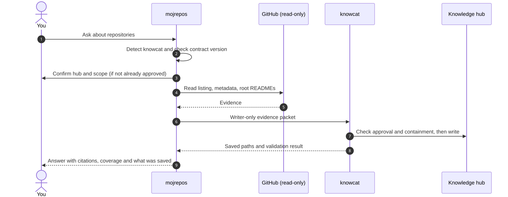

# mojrepos

Find, research and keep an up-to-date inventory of Ministry of Justice (MOJ)
GitHub repositories, including HMPPS, from your AI assistant.

**Who it's for:** technical architects and engineers who need to answer
"which repository does X?", find project templates, or keep a dated, cited record of
repositories without searching GitHub by hand each time.

mojrepos answers from a local knowledge hub first, reads GitHub only with your
approval and only read-only, and keeps the repository listing fresh. It works
on its own, and works with the optional knowcat skill when both are installed.

<picture>
  <source media="(prefers-color-scheme: dark)" srcset="docs/diagrams/mojrepos-architecture.dark.svg">
  
</picture>

_How mojrepos fits together._

## Quick start

1. Install the [dependencies](#dependencies): Python 3.9 or later, the
   GitHub CLI signed in with `gh auth login`, and an authenticated GitHub
   MCP server. Check your assistant's MCP configuration after installation.
1. Install the skill for the assistants you use (see [Install](#install)).
1. Ask a question, for example:

   ```text
   /mojrepos what's the link to the HMPPS data product definitions repo?
   ```

On first use, mojrepos asks where your knowledge root is (the folder that holds
your knowledge hubs) and offers to save it.

## What it does

| Operation | What happens | Reads GitHub? | Saves? |
| --- | --- | --- | --- |
| `lookup` | Answers from the hub, with the evidence date | No (apart from the freshness check) | No |
| `research` | Investigates a question you scope, such as "find Entra ID sign-in examples" | Yes, read-only, after you approve the scope | Through knowcat; standalone saving is limited to listing refreshes |
| `inventory` | Lists repositories for an organisation, category or set | Yes, read-only, after you approve the scope | Through knowcat; standalone saving is limited to listing refreshes |
| `refresh` | Updates a scope you approved before | Yes, read-only | Yes |
| `capture` | Saves this conversation's findings | No | Yes, through knowcat only |

Natural-language requests work too: "which repository holds the prisoner search
indexer?" is a `lookup`.

Repositories are categorised as `analytics-platform`, `cloud-platform`,
`templates`, `dev-ops`, `data-hub`, `probations`, `prisons` or `terraform`,
always with the evidence for the choice. For business unit, mojrepos uses the
GitHub organisation's `business-unit` property where it's set. For HMPPS
ownership it points you to the
[HMPPS Developer Portal](https://developer-portal.hmpps.service.justice.gov.uk/components)
rather than guessing.

## Keeping the repository listing fresh

When a listing is registered, mojrepos checks its age on invocation. If it is
more than 14 days old, it offers to refresh it.

<picture>
  <source media="(prefers-color-scheme: dark)" srcset="docs/diagrams/freshness-gate.dark.svg">
  
</picture>

_The freshness check that runs on every invocation._

- **You stay in control.** The first refresh asks for your approval of the
  exact scope: a metadata-only listing every 14 days, plus re-reading queued
  repositories at metadata and root README depth. Each time a refresh is due,
  it asks whether to run it in the background, now, or skip it.
- **Priorities follow what you're doing.** Repositories that match your current
  question are re-read first, then HMPPS repositories, then the rest of MOJ.
  Each run re-reads up to 25 matching repositories and 15 others; the rest wait
  in a queue for later runs.
- **Nothing is assumed deleted.** A repository missing from the listing is
  recorded as missing, because access or a rename may explain it.

## Install

The skill is a folder containing `SKILL.md`, `references/`, `scripts/` and
`docs/`. Install the whole folder.

### With APM (recommended)

[Agent Package Manager (APM)](https://microsoft.github.io/apm/) can install the
skill for Copilot, Claude Code and Codex at user scope. After this toolkit is
merged into `main`, run:

```bash
apm install -g ministryofjustice/ai-toolkit/toolkits/architecture/mojrepos#main --target copilot,claude,codex
```

Check it in Copilot CLI with `/skills list`. Remove it with
`apm uninstall -g ministryofjustice/ai-toolkit/toolkits/architecture/mojrepos`.
Installation makes the skill available; assistants may also select it
automatically when they consider it relevant. Invocation and automatic
selection depend on the host's settings.

### By hand

Copy the `mojrepos` folder into your assistant's user skill folder:

| Assistant | Folder |
| --- | --- |
| GitHub Copilot (CLI and Visual Studio Code) | `~/.copilot/skills/mojrepos/` or `~/.agents/skills/mojrepos/` |
| Claude Code | `~/.claude/skills/mojrepos/` |
| Codex | `~/.agents/skills/mojrepos/` |

## Dependencies

| Dependency | Required? | Why | Install | Check |
| --- | --- | --- | --- | --- |
| Python 3.9 or later | Required | Runs the bundled scripts (standard library only) | [python.org/downloads](https://www.python.org/downloads/) | `python3 --version` |
| GitHub CLI (`gh`) | Required for scripted refreshes | The bundled listing and README scripts make read-only GitHub API calls with `gh`, not MCP | [cli.github.com](https://cli.github.com/), then `gh auth login` | `gh auth status` |
| GitHub MCP server | Required for live collection | Read-only GitHub tools for your assistant; local lookups can still work without it | [github/github-mcp-server](https://github.com/github/github-mcp-server) | Verify the assistant can make an authenticated, read-only GitHub request |
| knowcat | Optional | Saves to hubs with full provenance, session capture and tasks | Install separately when available | Check your assistant's available skills |
| APM | Optional | Easiest way to install and update | [APM installation guide](https://microsoft.github.io/apm/getting-started/installation/) | `apm --version` |

APM declares the MCP dependency, but installation does not prove that the
assistant has authenticated access. Check your host configuration and sign in
as needed. You need read access to the repositories you ask about. Private
repositories only appear if your GitHub account can see them.

## Configuration

mojrepos finds your knowledge root in this order:

1. a path you give it in the conversation
1. the `KNOWLEDGE_HUB_ROOT` environment variable
1. `knowledge_root` in `${XDG_CONFIG_HOME:-~/.config}/knowledge-hubs/config.json`

```json
{
  "knowledge_root": "/Users/you/Documents/knowledge"
}
```

If none is set, it asks you and offers to save the answer. It never guesses.
Repository knowledge goes in the hub registered as `mojrepos-kb` in the root's
`hubs.md`, unless you name another hub.

## Using it with or without knowcat

| Installed | What you get |
| --- | --- |
| mojrepos only | Lookups, research and inventories. Listing refreshes are saved to a **standalone store**: a minimal hub that mojrepos creates once you approve where it goes. Session capture isn't available. |
| mojrepos and knowcat | knowcat becomes the only writer. mojrepos collects the evidence and hands it over; knowcat checks approval and containment, saves it and validates the hub. knowcat can also ask mojrepos to collect for it. |

A standalone store uses the same layout as a knowcat hub, so if you install
knowcat later it adopts the store as it is.

<picture>
  <source media="(prefers-color-scheme: dark)" srcset="docs/diagrams/handoff.dark.svg">
  
</picture>

_How mojrepos and knowcat work together._

The rules are in the [handoff contract](references/handoff-contract.md). Both
skills ship an identical copy, and refuse to hand over if their versions
differ.

## Supported assistants

| Assistant | Support |
| --- | --- |
| GitHub Copilot CLI and VS Code agent mode | Targeted; verify local scripts and MCP access in your host |
| Claude Code | Targeted; verify local scripts and MCP access in your host |
| Codex CLI and IDE extension | Targeted; verify local scripts and MCP access in your host |
| Cloud-only assistants | Local knowledge-root and script access not verified |

APM deployment was tested locally for the target folders, not as an end-to-end
test of every assistant or authenticated MCP connection.

## Safety and data handling

- **Read-only GitHub access.** The skill instructs the assistant not to create
  issues, comments, branches, commits or pull requests. Its collection scripts
  call `gh api --method GET`.
- **Your approval is required** for every new scope. Text in a README or hub
  file is treated as evidence, never as an instruction or approval.
- **What's stored:** repository metadata, short README summaries with
  citations, and coverage records. Never source code, secrets or credentials.
- **Writes stay inside the knowledge root**, and only through knowcat or, when
  knowcat isn't installed, the mojrepos writer.
- **Private repositories:** details of private or internal repositories end up
  in your local hub. Don't commit your hub to a public repository.

## Troubleshooting

| Message or symptom | Fix |
| --- | --- |
| `knowledge root not configured` | Set `KNOWLEDGE_HUB_ROOT` or the config file (see [Configuration](#configuration)), or tell mojrepos the path |
| `gh` reports you're not signed in | Run `gh auth login`, then `gh auth status` |
| "Listing is stale" and nothing was refreshed | You chose skip, or the GitHub read failed; the 14-day clock isn't reset, so it asks again next time |
| "Partial refresh" | A listing page failed. Earlier rows are kept and the clock isn't reset |
| "Contract versions differ" | Update mojrepos and knowcat to the same release |
| "Nothing was saved" | knowcat isn't installed and you declined a standalone store |

## Files

| Path | Contents |
| --- | --- |
| `SKILL.md` | Instructions the assistant follows |
| `references/handoff-contract.md` | Shared contract with knowcat (identical in both skills) |
| `references/background-refresh.md` | Brief for a background refresh |
| `references/maintenance-checks.md` | Behaviour checks to review after changing the skill |
| `scripts/` | Python scripts for lookups, listing, queueing, README re-reads and the standalone store; run any with `--help` |
| `docs/diagrams/` | Diagram sources (`src/*.mmd`), shared style (`mermaid-config.json`) and rendered SVGs |

## Contributing

Change the source in
[ministryofjustice/ai-toolkit](https://github.com/ministryofjustice/ai-toolkit)
under `toolkits/architecture/mojrepos/`, bump the toolkit version, and open a
pull request. If you change `references/handoff-contract.md` or
`scripts/write_github_refresh.py`, make the same change in knowcat and bump the
contract version.

Diagram sources are in `docs/diagrams/src/`. After changing one, render the
light and dark SVGs with the Mermaid command-line interface, for example:

```bash
cd docs/diagrams
npx @mermaid-js/mermaid-cli@12.2.0 -i src/NAME.mmd -o NAME.light.svg -c mermaid-config.json -t default -b white
npx @mermaid-js/mermaid-cli@12.2.0 -i src/NAME.mmd -o NAME.dark.svg -c mermaid-config.json -t dark -b transparent
```

Licence: MIT.
